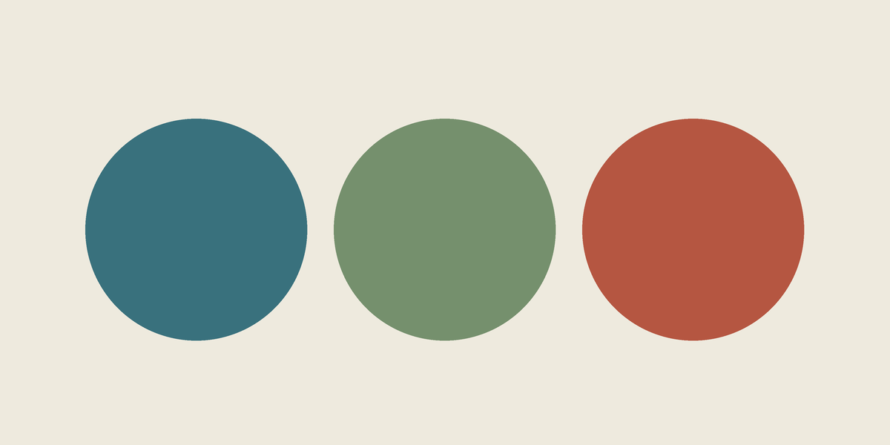

同样大小的三枚色块，并排放在同一张纸上。先看第一眼落在哪里，再看它为什么停在那里。

## 先看颜色

湖蓝在左，草绿居中，砖红在右。三种颜色各占相同的面积，和旁边色块的距离也一样。

## 再看相邻的颜色

1. 用手挡住左侧的湖蓝，只看草绿和砖红。
2. 移开手，再挡住右侧的砖红，看草绿和湖蓝。
3. 比较两次印象，记下你觉得中间这枚绿色更亮的那一次。

**中间的绿色一直没有变。** 如果你两次看到的颜色有些不同，值得再看一眼的，是它身边的颜色。

> 看一种颜色时，我们也在看它和另一种颜色的关系。
